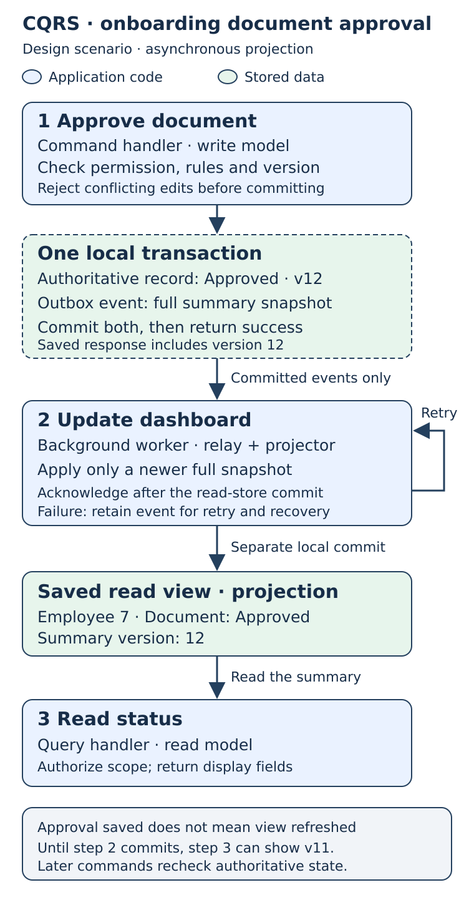
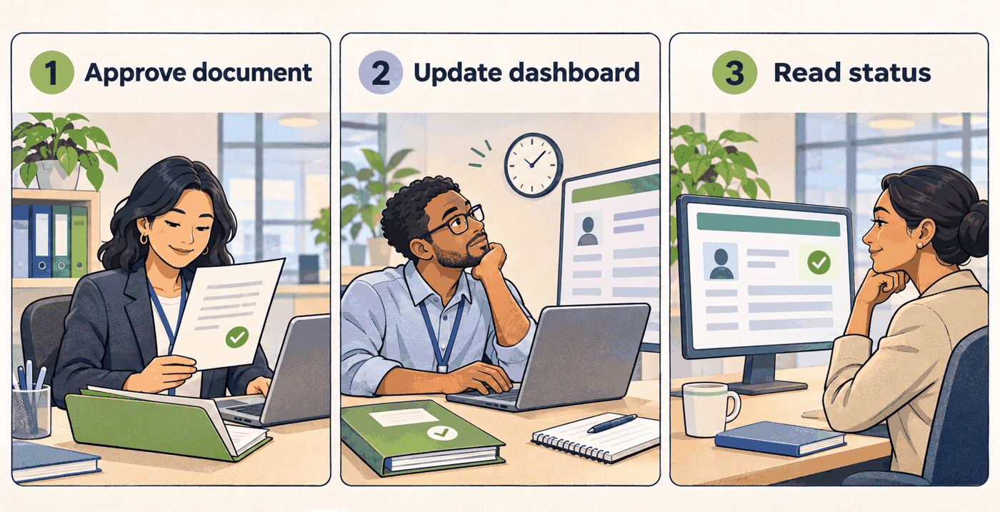

# CQRS

**Separate the rules for changing data from the shape used to read it.**

An HR officer approves an onboarding document. That action must check permission, document state and concurrent edits. A manager opening the onboarding dashboard needs a compact summary. Making both operations use the same model can mix business rules with display concerns.

**CQRS — Command Query Responsibility Segregation — separates the write model from the read model.** A command expresses an intended change; a query returns information without changing business state. Separate HTTP methods or handler classes alone do not establish this model separation.

## Document approval and the onboarding dashboard

**Design scenario:** a document approval feeds an onboarding summary. The models, event format and recovery policy below are proposed, not an audit of a deployed application. No technology stack is assumed.

| Responsibility | Example | Model |
| --- | --- | --- |
| Command | `ApproveDocument(employeeId, documentId, expectedVersion)` | An onboarding record with rules for valid changes. |
| Query | `GetOnboardingSummary(employeeId)` | A display object containing name, department and document status. |

Both paths enforce authorization and tenant scope. The query does not execute approval rules.

The simplest version keeps both models in one application and one database: command logic changes the records; query logic selects a display object from them. Separate databases, messaging and event sourcing are optional.

The following version adds a **projection**, a stored read view derived from authoritative data, when repeated dashboard queries justify it.

1. **Approve document.** The command handler checks business rules and the expected record version. In one transaction, it saves the approved document, increments employee 7's version to 12, and inserts an outbox event containing a full snapshot of the summary fields. A conflicting edit is rejected. Success is returned after this commit.
2. **Update dashboard.** A background worker reads committed outbox events. Its projector function writes the summary and version 12 atomically to the read store, then marks the event delivered. It applies only a version newer than the stored version. A crash before acknowledgement can cause redelivery; the version guard makes repeating that snapshot harmless.
3. **Read status.** The query handler reads the saved summary. It may still show version 11 after approval succeeds: the projection has not caught up. The response from stage 1 confirms the save; the UI shows “Saved; dashboard updating” until its summary reaches at least version 12. Later commands always recheck authoritative state.

## The same workflow at the office

The approved folder represents authoritative data; the dashboard represents its read view. The second person represents background projection work. The human scene shows the delay, not actual locking or delivery guarantees.

## Benefit and cost

Approval rules stay focused while the dashboard gets a convenient read shape. Separate infrastructure can allow independent scaling. The asynchronous version adds storage, delivery work and temporary staleness. Failed projection work needs saved retries, monitoring and recovery; the successful approval remains committed.

Use model separation where rules and reads diverge. Introduce asynchronous projections only when their benefit justifies the consistency cost; simple CRUD may be sufficient elsewhere.

[Optional recovery rules and primary sources](reference.md) · [Editable process diagram](assets/cqrs-process.svg)
