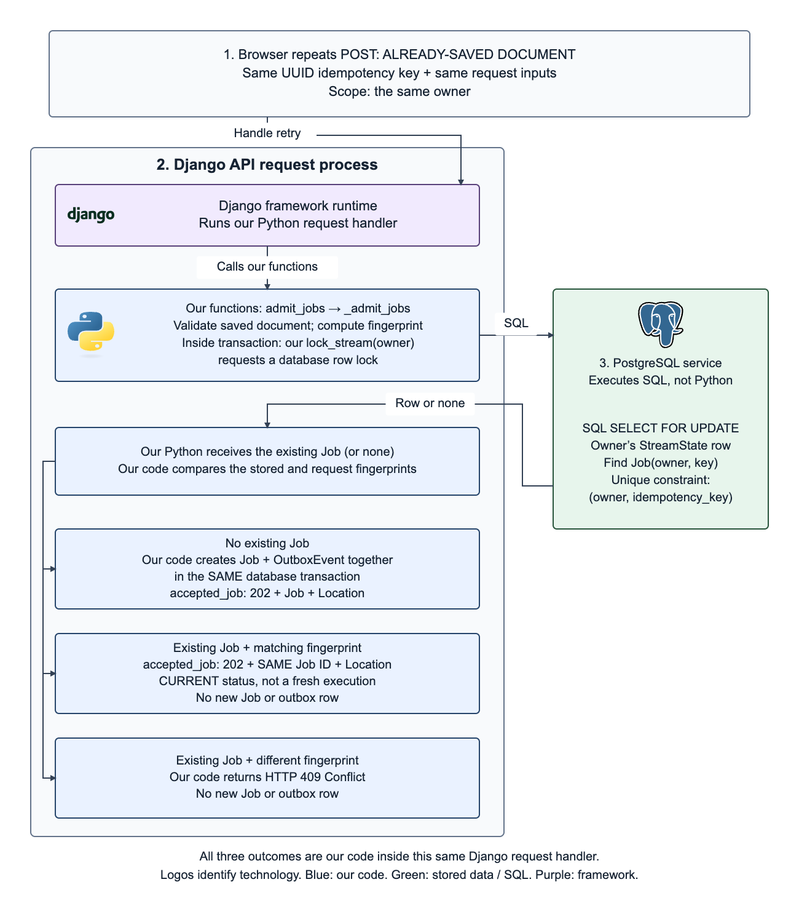
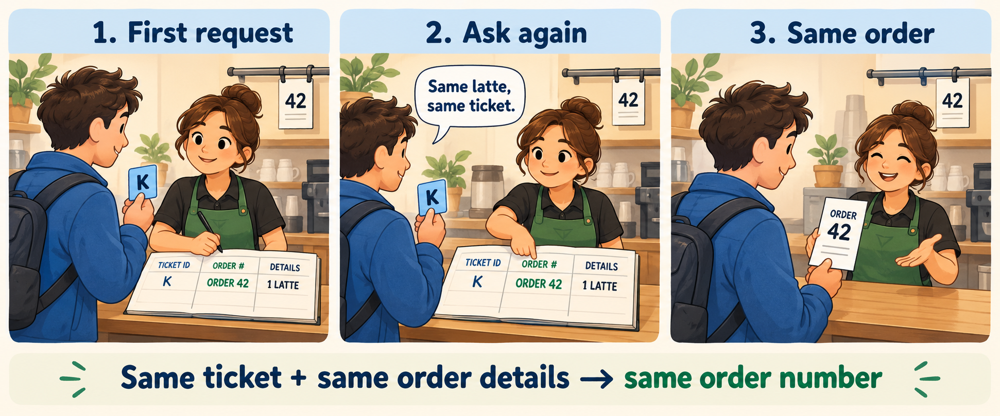

# Request idempotency

**Same request. Same job.**

You submit a résumé for matching. The response disappears, so you try again. Should the app create another job? **Request idempotency** lets the API recognize that retry and return the existing job.

Here, “same request” means **the same signed-in owner, the same UUID `Idempotency-Key`, and matching meaningful inputs**, while the job identity is retained. A UUID is a unique identifier; the caller reuses this key for retries.

## Follow a request for an already-saved résumé

Our example uses one saved résumé document and one job description. We call the request key **K** and the resulting job **42** to make the pictures readable; the real API uses UUIDs.

**Roles:** the client sends the request; the Django API process runs **our Python functions**; PostgreSQL is the separate database service holding job records. Neither a function nor a saved job is another running process.

**Colors:** blue = our application code; green = stored data; purple = framework/runtime roles. Labels identify each role too.

1. **Browser request.** The client sends key K with its inputs. A retry keeps the same key instead of generating another.
2. **Django API process.** Our `admit_jobs` → `_admit_jobs` functions validate the request and calculate a fingerprint: a hash summarizing meaningful inputs. Inside `transaction.atomic`, our code calls the `lock_stream(owner)` helper and queries PostgreSQL.
3. **PostgreSQL database service.** A database row lock coordinates requests for that owner. The lookup finds any `Job` with that owner and key. PostgreSQL also enforces `unique(owner, key)` so that pair cannot identify two jobs. The lock and constraint are database protections, not separate workers.

**Back inside the same Django process, our code chooses:**

- **Matching stored inputs:** reuse job 42. `accepted_job` returns its UUID and **current state**; the state may have advanced since the first request.
- **Same key, different inputs:** return **409 Conflict** without creating another job.
- **Unused key:** new work can be accepted. For this saved-document path, save the queued `Job` and its `OutboxEvent` reminder together in the transaction, then return `accepted_job`.

## The same idea in a café

The customer is the **client**, the cashier is the **API**, and the ledger is **PostgreSQL**. K already points to order 42 for one latte, so asking again produces the same order identifier. The receipt does not prove that the drink is finished. The paper scene does not implement database locking or uniqueness.

## Benefit and limits

Retries reuse accepted work without creating another job or charging another daily-quota unit. Only a new logical request consumes that quota and reserves capacity.

The app must retain the request identity and compare inputs. A new key can create new work; this protection is not permanent after retention ends. It prevents repeated **API acceptance**, not RabbitMQ redelivery, repeated Celery execution or every repeated external call.

[Optional source and boundary notes](reference.md) · [Editable process figure](assets/request-process.svg)
