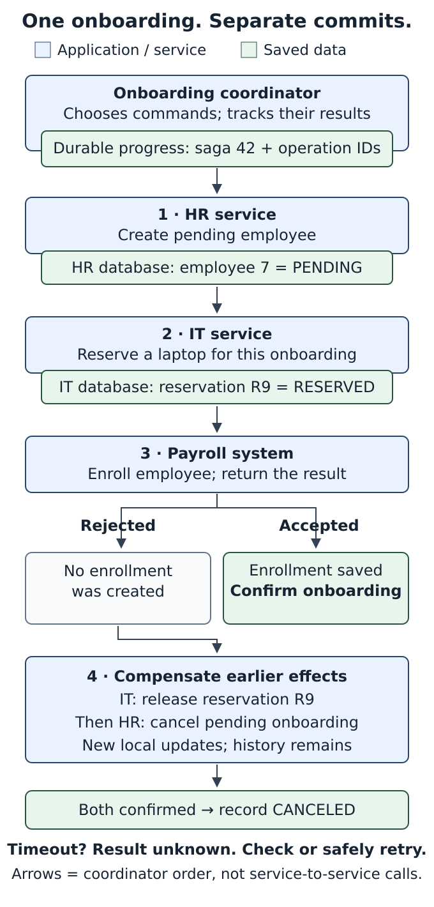
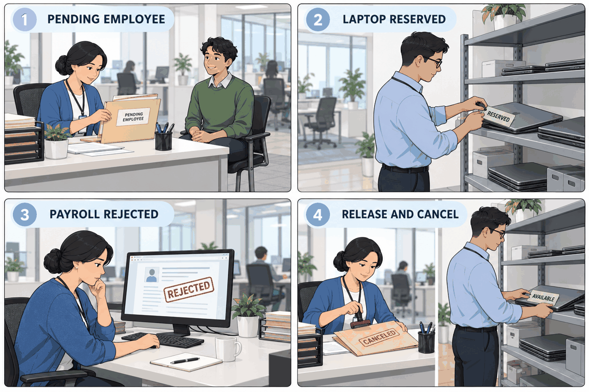
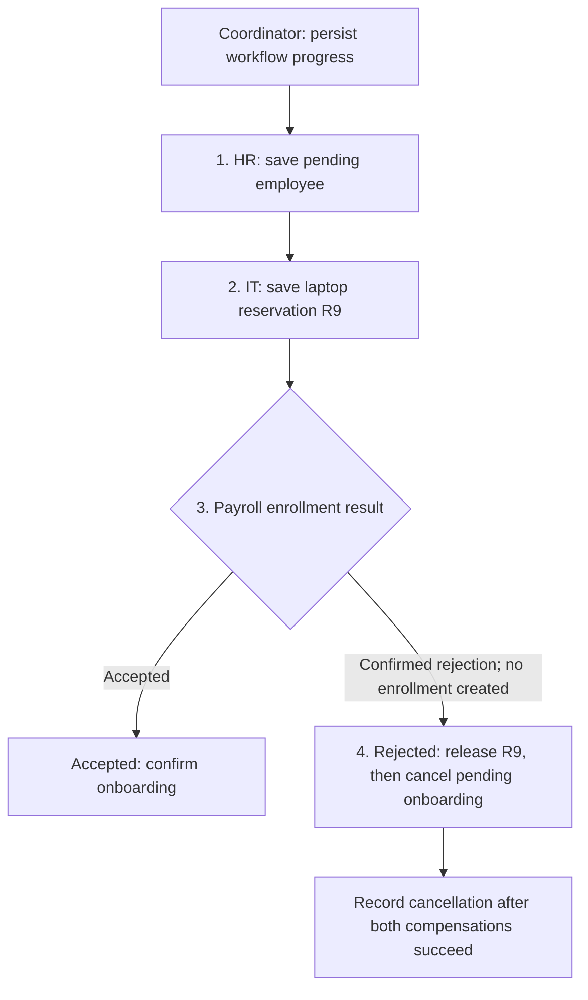

# Saga

**Complete the workflow. Compensate when it must stop.**

Employee onboarding can touch HR, IT and payroll. HR creates a pending employee and IT reserves a laptop, but payroll rejects enrollment. The earlier saves still exist: onboarding is incomplete and the laptop remains reserved.

A **saga** coordinates a sequence of local transactions. Each system saves its own step. If the workflow must stop, **compensation** applies planned business actions to reverse earlier effects.

## Employee onboarding

**Design scenario:** HR, IT and payroll own separate data stores. Setup stays provisional until all required steps succeed. The example's cancellation policy permits releasing equipment and canceling pending onboarding before employee activation.

The **onboarding coordinator** is application code that chooses the next action. Its saved progress is data, not another worker. HR and IT are services; payroll is an integration with another system. No specific technology stack is assumed.

**Reading order:** top to bottom, then the accepted or rejected branch. Blue = application code/service; green = saved data. Labels identify both roles. Arrows show the coordinator's ordered workflow, not direct calls between HR and IT.

1. **Create pending employee.** HR saves employee 7 as pending in its own database. The coordinator records success.
2. **Reserve laptop.** IT saves reservation R9 for this onboarding. The coordinator retains R9 so recovery can target that reservation.
3. **Enroll in payroll.** Accepted enrollment allows the coordinator to confirm onboarding. A confirmed rejection, with no enrollment created, takes the compensation path.
4. **Release and cancel.** IT releases R9; HR cancels the pending onboarding and keeps its history. The coordinator records cancellation only after both actions succeed.

These are new updates in the owning systems. A rollback in payroll cannot undo HR's earlier commit. Compensation follows business rules; it does not rewind every database to an earlier snapshot.

## The same workflow at the office

The folder represents HR's pending record, the tagged laptop represents IT's reservation, and the rejected form represents payroll's result. The office illustration makes the business actions visible; it does not implement durable progress, retries or concurrency control.

## Benefit and cost

The workflow can recover across independent systems without holding one database transaction open across them. Recovery takes time, so the overall status may remain **Pending** or **Compensating**. Each local transaction is atomic; the whole saga is not one isolated, all-or-nothing database transaction.

**A timeout is an unknown result.** The coordinator checks or safely retries the same operation before deciding what happened. Repeated commands must avoid duplicate effects. Failed compensation remains saved for retry or operator recovery.

[Optional recovery rules and primary sources](reference.md) · [Editable process diagram](assets/saga-process.svg)

Editable Mermaid outline

The arrows describe the coordinator's workflow order. Each system owns its local commit; a missing reply requires reconciliation, not an assumed rejection.

