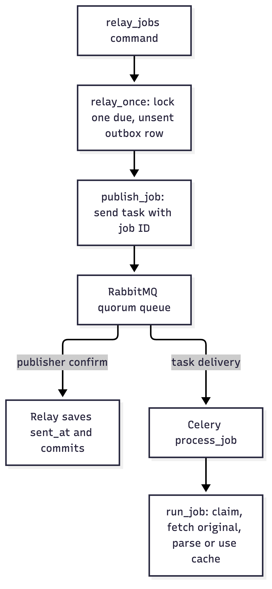
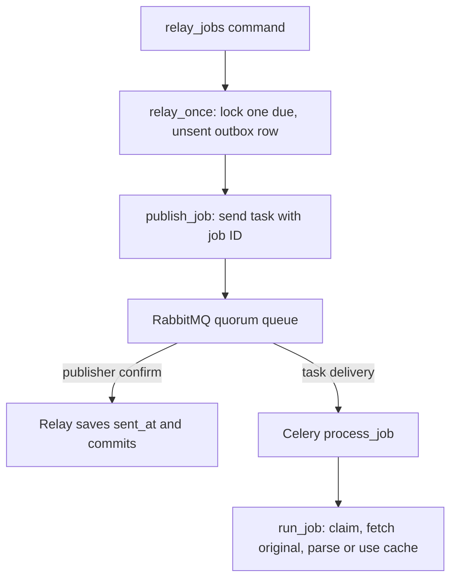
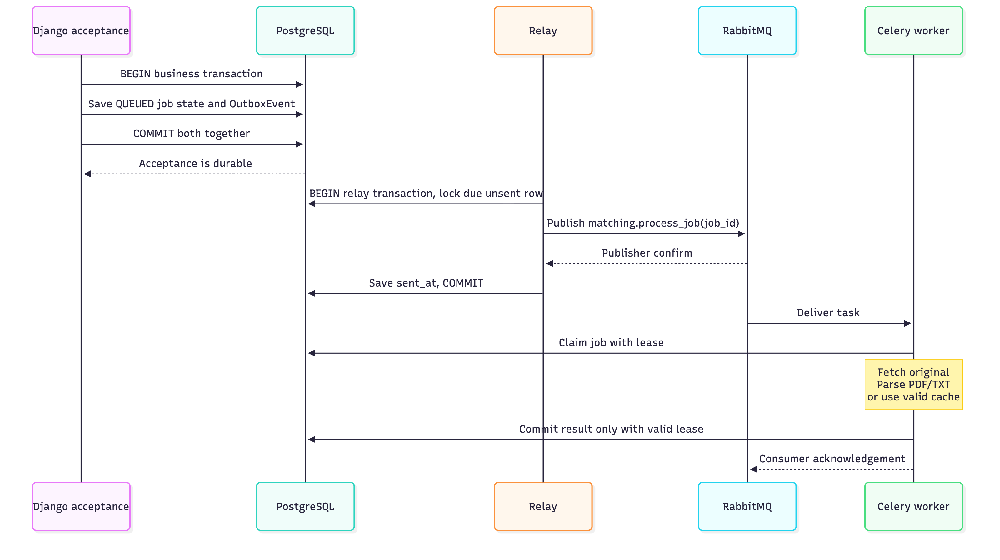
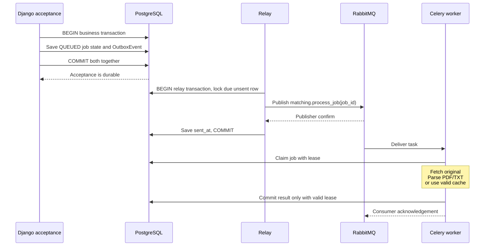
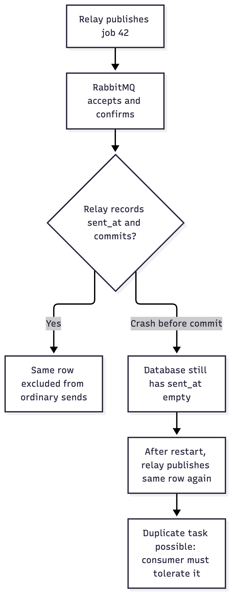
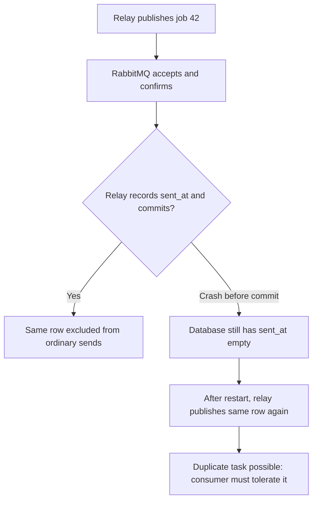

# Transactional outbox

**Save the business change and “send this work” in one database transaction. A relay sends the work to the broker later.**

In Résumé Match, the business change is a job becoming ready for processing. The outbox row remembers that this job still needs a dispatch. PostgreSQL commits both together or rolls both back. RabbitMQ publication happens separately; there is no atomic PostgreSQL-plus-RabbitMQ transaction.

## Why it exists

Imagine saving a job, then calling RabbitMQ. If the app crashes between those actions, the job exists but no worker hears about it. Publishing first has the opposite problem: a worker might receive work whose database transaction later rolls back.

The outbox removes that unrecorded handoff. A committed job has a durable dispatch intention that a functioning relay can retry. Eventual delivery still depends on recovery, running processes, available storage and a working broker; it is not an unconditional promise.

## A café picture


The cashier accepts the order; the ticket rail holds work; the barista prepares it. In the application these correspond to Django, RabbitMQ and the Celery worker.

**The outbox adds a step before the rail:** imagine recording the order and “put its ticket on the rail” together in a durable order book. A relay reads that instruction and places the ticket on the rail. If the rail is unavailable, the instruction remains in the book.

The generated café illustration is reused from the RabbitMQ lesson and was inspected on 24 October 2026. It depicts the queue and worker, not the database, outbox, relay, confirmations or atomic transaction. Ticket numbers are identifiers here, not an ordering guarantee. A real paper book does not provide database rollback or concurrency control.

## Follow the relay

The job and its outbox row have already committed when this path begins.





The two arrows out of RabbitMQ describe different responsibilities. A publisher confirm tells the relay about broker acceptance; it does not say that PDF processing finished. The worker can receive the task before the relay commits `sent_at`.

## Where the transaction ends





This sequence shows one successful interleaving. Delivery to the worker may occur earlier; the publisher and consumer acknowledgements are independent. Error handling can finish an attempt without a successful report, so a consumer acknowledgement is not the report's status field.

**Two distinct transactions matter:** the business transaction does not wait for RabbitMQ. This particular polling relay holds its own outbox-row database transaction and lock while publishing over the network. Moving dispatch later does not mean every network call is outside every transaction.

For a fresh upload, the original S3-compatible object PUT also happens outside the business finalization transaction. The outbox does not make that object write atomic with PostgreSQL.

## Four things with different meanings

| Thing | Where it lives | What it means |
| --- | --- | --- |
| `Job.status` | PostgreSQL | Business processing state: uploading, queued, running or a terminal outcome |
| `OutboxEvent` | PostgreSQL | A dispatch instruction for a job; `available_at` controls eligibility and empty `sent_at` means not recorded as sent |
| Task message | RabbitMQ | An instruction naming `matching.process_job` and the job ID; it carries neither the PDF nor the result |
| Consumer acknowledgement | Broker protocol | The consumer has handled that delivery according to its acknowledgement policy; separate from publisher confirmation and report status |

`sent_at` records dispatch, not completion. It excludes the **same outbox row** from normal later selection. Retry or recovery can intentionally create a **new outbox row for the same job**.

## The duplicate window





The database cannot tell whether the broker already accepted the message if that acceptance was never recorded durably. Retrying protects delivery but can send twice. Marking the row before publishing would introduce a loss window instead.

Consumers therefore need idempotency: repeated work must not create repeated harmful effects. In this app, job state and a database lease control who can claim work; completion checks the matching unexpired lease. This fences stale database writes. It does **not** guarantee exactly one external provider call or exactly-once effects everywhere.

## Benefits and costs

| Benefit | Cost or boundary |
| --- | --- |
| Committed work retains its dispatch intent after an app crash | Relay must keep running or recover; dispatch is eventual |
| Acceptance tolerates temporary broker unavailability | Backlog grows during an outage; storage and capacity still have limits |
| Pending rows make retries and backlog inspectable | Needs cleanup/retention policy, alerts and operational ownership |
| Acceptance transaction avoids a broker round trip | This relay still holds a database lock during publishing |
| Dispatch can be retried after uncertain outcomes | Duplicates require consumer protection |

Watch pending-row count and oldest due-row age, publication failures and job recovery outcomes. Sorting by `created_at` is a selection preference, not a global processing-order guarantee: concurrent relays can skip locked rows, and retries or workers can finish in another order. Workflows requiring strict per-entity ordering need an explicit design for it.

Use this pattern when an accepted database change must reliably trigger asynchronous work and missing that work matters. If all required work is a small update inside one database transaction, keep that simpler design. An in-memory callback after commit alone does not preserve dispatch intent across a process crash.

## Résumé Match: source map

Inspected **24 October 2026**, clean revision [`66c0985`](https://github.com/junrillg/resume-match-bedrock/tree/66c0985efe2f1fb4ca04871b877d3de5e850cd47). These immutable links need access to the source repository.

| Step | Pinned code | What to notice |
| --- | --- | --- |
| Existing-document acceptance | [views.py, lines 309–352](https://github.com/junrillg/resume-match-bedrock/blob/66c0985efe2f1fb4ca04871b877d3de5e850cd47/backend/matching/views.py#L309-L352) | Creates queued Job and OutboxEvent in one transaction |
| Fresh-upload finalization | [views.py, lines 339–393](https://github.com/junrillg/resume-match-bedrock/blob/66c0985efe2f1fb4ca04871b877d3de5e850cd47/backend/matching/views.py#L339-L393) | Job initially UPLOADING; PUT at 362; transaction at 366 updates Job to QUEUED and adds outbox at 393 |
| Outbox record | [models.py, lines 102–110](https://github.com/junrillg/resume-match-bedrock/blob/66c0985efe2f1fb4ca04871b877d3de5e850cd47/backend/matching/models.py#L102-L110) | Job reference, due time, creation time and nullable sent time |
| Relay loop | [relay_jobs.py, lines 22–70](https://github.com/junrillg/resume-match-bedrock/blob/66c0985efe2f1fb4ca04871b877d3de5e850cd47/backend/matching/management/commands/relay_jobs.py#L22-L70) | Reuses producer, bounded batches, idle wait, separate maintenance; supports `--once` |
| Publish and mark | [jobs.py, lines 175–216](https://github.com/junrillg/resume-match-bedrock/blob/66c0985efe2f1fb4ca04871b877d3de5e850cd47/backend/matching/jobs.py#L175-L216) | Due + unsent, row lock with `skip_locked`, publish, then save sent_at |
| Delivery configuration | [celery.py, line 13](https://github.com/junrillg/resume-match-bedrock/blob/66c0985efe2f1fb4ca04871b877d3de5e850cd47/backend/config/celery.py#L13), [settings.py, lines 124–143](https://github.com/junrillg/resume-match-bedrock/blob/66c0985efe2f1fb4ca04871b877d3de5e850cd47/backend/config/settings.py#L124-L143) | Durable quorum queue, publisher confirms, persistent messages and late worker acknowledgements |
| Worker entry | [tasks.py, lines 6–12](https://github.com/junrillg/resume-match-bedrock/blob/66c0985efe2f1fb4ca04871b877d3de5e850cd47/backend/matching/tasks.py#L6-L12), [jobs.py, lines 104–120](https://github.com/junrillg/resume-match-bedrock/blob/66c0985efe2f1fb4ca04871b877d3de5e850cd47/backend/matching/jobs.py#L104-L120) | process_job → run_job → claim_job → document_text |
| Original and parser | [documents.py, lines 147–183](https://github.com/junrillg/resume-match-bedrock/blob/66c0985efe2f1fb4ca04871b877d3de5e850cd47/backend/matching/documents.py#L147-L183), [services.py, lines 36–66](https://github.com/junrillg/resume-match-bedrock/blob/66c0985efe2f1fb4ca04871b877d3de5e850cd47/backend/matching/services.py#L36-L66) | Worker fetches original and parses PDF/TXT or uses a valid cache; RabbitMQ does not run Python |
| Duplicate protection | [jobs.py, lines 51–101](https://github.com/junrillg/resume-match-bedrock/blob/66c0985efe2f1fb4ca04871b877d3de5e850cd47/backend/matching/jobs.py#L51-L101) | Claim lease and fenced database completion |
| Later dispatch for same job | [jobs.py, lines 41–48](https://github.com/junrillg/resume-match-bedrock/blob/66c0985efe2f1fb4ca04871b877d3de5e850cd47/backend/matching/jobs.py#L41-L48), [144–171](https://github.com/junrillg/resume-match-bedrock/blob/66c0985efe2f1fb4ca04871b877d3de5e850cd47/backend/matching/jobs.py#L144-L171) | Retry/recovery can create a new outbox row |

Exact excerpt from `relay_once` (source inspection; not executed in this lesson):

```python
event.sent_at = timezone.now()
event.save(update_fields=["sent_at"])
```

These lines run only after `publish_job` returns successfully. Before them the relay selects a due, unsent row under a database lock. On publication failure it leaves the row unsent. Expected normal result: the relay commits a sent timestamp while the job may still be queued or running.

[Existing failure-test source](https://github.com/junrillg/resume-match-bedrock/blob/66c0985efe2f1fb4ca04871b877d3de5e850cd47/backend/matching/test_jobs.py#L233-L255) covers broker outage and a simulated crash after confirmation before saving sent_at. It also checks duplicate `run_job` calls produce one Match. These tests were read, not rerun for this docs-only lesson; they do not prove all external effects occur once.

## Read or watch next

Primary references checked on 24 October 2026:

- [Chris Richardson: Transactional outbox](https://microservices.io/patterns/data/transactional-outbox.html) — recommended short mechanism reference, especially the relay crash/duplicate explanation. Free text; stack-independent.
- [AWS transactional outbox guidance](https://docs.aws.amazon.com/prescriptive-guidance/latest/cloud-design-patterns/transactional-outbox.html) — the database-plus-message problem and implementation options. Its AWS examples differ from this RabbitMQ polling relay.
- [RabbitMQ publisher confirms and consumer acknowledgements](https://www.rabbitmq.com/docs/confirms) — explains the two independent handoffs. The fetched documentation reports version 4.4; check your deployed version before configuring it.
- [RabbitMQ reliability guide](https://www.rabbitmq.com/docs/reliability) — durability, retransmission and consumer responsibilities.
- Optional video: [The outbox pattern with Apache Kafka and Debezium](https://www.youtube.com/watch?v=wEhr-mnPOeQ), linked by [Red Hat Developer's article](https://developers.redhat.com/articles/2021/09/01/outbox-pattern-apache-kafka-and-debezium) by Don Schenck, 1 September 2021 (article updated 17 November 2023). Useful for seeing a CDC relay variant. The official article and video link were verified; direct playback, duration, chapter timestamps and exact software versions were not. No subscription/enrollment checked. No suitable exact LinkedIn Learning lesson was verified. Watching is optional and does not complete a lab.

## Verification and learning limits

The repository contains educational explanations and source-grounded diagrams. Mermaid syntax, static renderings and links are checked separately from the application's behavior. No broker, worker, application tests, PDF handler, provider or AWS service was run for this lesson. No learner coding or independent understanding is established by publishing these notes.
