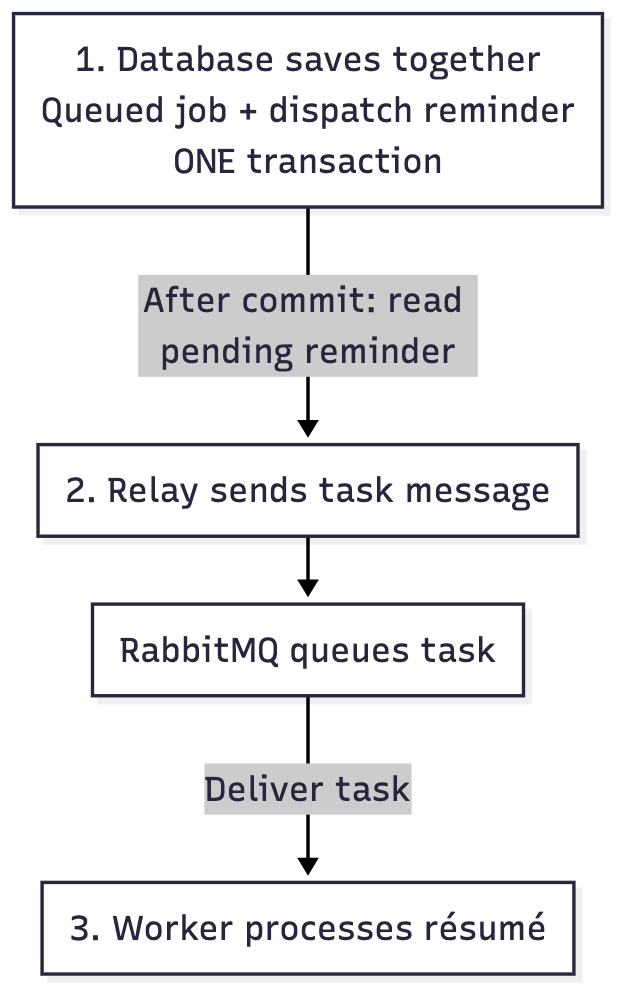
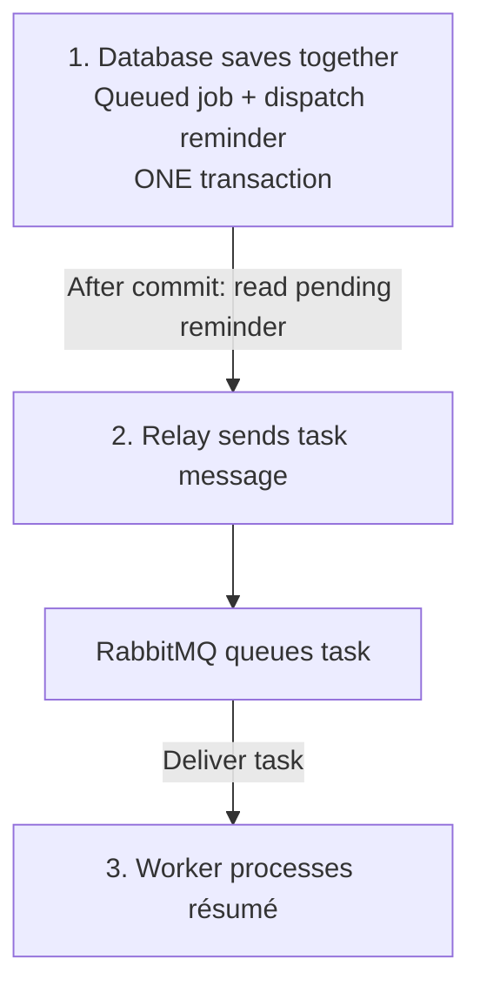

# Transactional outbox

**Save together. Send later.**

## Start here

Without an outbox, the app could save a résumé job, then crash before telling a worker. The job exists, but its dispatch instruction may be lost.

The transactional outbox prevents that forgotten handoff. An **outbox** is a database table of dispatch reminders. A **relay** is the background sender that reads them.

Follow one résumé job through the picture:

1. **Save together.** Save its queued state and a dispatch reminder in **one database transaction**: both are saved, or neither is.
2. **Send later.** After that transaction commits, the relay sends the reminder’s task message to RabbitMQ, the message queue. It records the reminder as sent only after RabbitMQ confirms acceptance. If sending fails, the reminder stays pending for retry.
3. **Do the work.** RabbitMQ delivers the task to a worker, which processes the résumé. “Sent” does not mean “finished.”

**Benefit:** a crash or temporary queue outage leaves a saved reminder to retry when the relay and queue recover.

**Cost:** work can start later, and retries can send the same message twice. The worker needs protection against repeated effects.

Remember: **save the job and reminder together; send the message later.**

You can stop here. [Optional details and sources](reference.md) explain failures and the actual code.

Editable diagram source

