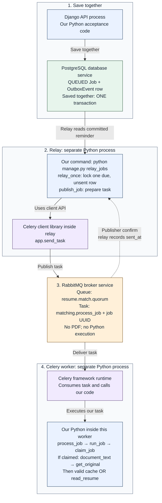

# Transactional outbox

**Save together. Send later.**

Without an outbox, the app could save a résumé job, then crash before telling a worker. The job exists, but the instruction to process it may be lost.

An **outbox** is a database table of dispatch reminders. Saving the job and its reminder together prevents that forgotten handoff. A **relay** is the background sender that turns a reminder into a task message.

## What is running?

This workflow spans separate running programs. Our Python functions run **inside** those programs; each function is not a new process.

| Name | What it is | Its role here |
| --- | --- | --- |
| Django API | Running Python API process | Runs our acceptance code. |
| PostgreSQL | Database service | Stores the job and reminder. The `OutboxEvent` model describes reminder rows; it is not a process. |
| Relay | Separate Python command process | Started with `python manage.py relay_jobs`; runs our sending functions. |
| Celery client | Python library used inside the relay | `app.send_task` publishes the task. It does not require the worker to run inside the relay. |
| RabbitMQ | Separate message-broker service | Holds and routes task messages. It does not execute Python or parse PDFs. |
| Celery worker | Separate Python worker process using the Celery framework | Receives a task and calls our Python task function. |

Celery is the **task framework**. Its client sends tasks; its worker runs tasks. RabbitMQ transports them. These are logical roles; deployments can have worker pools or multiple copies.

## Follow one résumé job

Read stages **1 → 2 → 3 → 4**. Boxes identify code, libraries and services. The return arrow is broker confirmation, not work completion.

**Colors:** blue = our Python code/processes; green = database and rows; orange = RabbitMQ broker; purple = Celery library/runtime. The labels also state each role.

**Logos identify the technology; labels explain the role.** Python marks our Python code. The Celery logo appears in both the sending library and the worker, which have different jobs.

Django and PostgreSQL use their official marks. RabbitMQ uses its name and a generic queue symbol because its published guidance restricts logo reuse. [Logo sources and guidance](assets/logos/sources.md).

[Editable diagram with embedded logos (SVG)](assets/outbox-process.svg). The collapsed Mermaid outline below preserves the same flow as text labels.

1. **Save together.** Our Django acceptance code saves the job’s `QUEUED` state and an `OutboxEvent` reminder in **one PostgreSQL transaction**. Both are saved, or neither is. This finishes before publishing.
2. **Send later.** Our `relay_jobs` command calls `relay_once`, which locks one due, unsent reminder. Our `publish_job` function uses the **Celery client API**, `app.send_task`, to publish. These functions all run in the relay process.
3. **Queue in RabbitMQ.** Its quorum queue holds `matching.process_job` and the job UUID, its unique identifier, **not the PDF**. After broker confirmation, the relay records `sent_at`. If publishing fails, the reminder stays pending.
4. **Execute in the Celery worker.** Celery receives the task and calls **our** `process_job` function. It calls `run_job`, then `claim_job`. If claimed, `document_text` first calls `get_original` to fetch and safety-check the file, then uses valid cached text or calls `read_resume` to parse it. Celery supplies the task machinery; these processing functions are our code.

## The same idea in a café

The cashier and order book represent **Django and PostgreSQL**. The runner is the **relay**, the waiting ticket rail is **RabbitMQ**, and the barista is the **Celery worker**. The saved reminder says “put this job’s ticket on the rail.”

In the picture, order **42** appears under both **ORDER** and **TO SEND**. The runner puts ticket **42** on the rail while the barista works on earlier ticket **17**: accepting new work and finishing earlier work happen separately.

The café explains the roles; a paper ledger does not provide database rollback, concurrency protection or duplicate controls.

## Why use it, and what is the catch?

**Benefit:** a crash or temporary RabbitMQ outage leaves a saved reminder to retry when the relay and queue recover.

**Cost:** work may start later, and retries can send twice. If RabbitMQ accepts a task but the relay crashes before saving `sent_at`, the reminder still looks unsent. The worker must tolerate repeated delivery. **Sent does not mean finished, and outbox does not mean exactly once.**

[Optional code boundaries and sources](reference.md) explain those safeguards. Remember: **save the job and reminder together; send the message later.**

Editable text-only Mermaid outline

