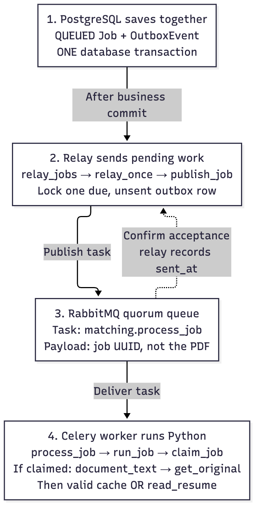
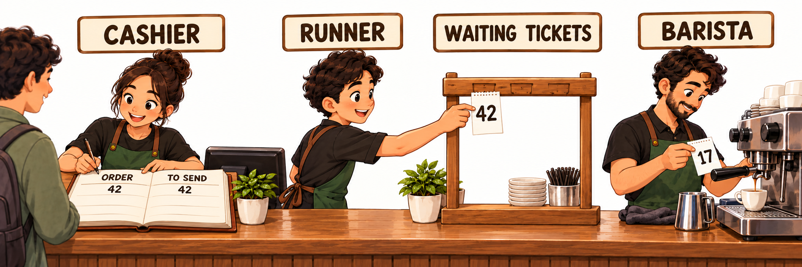
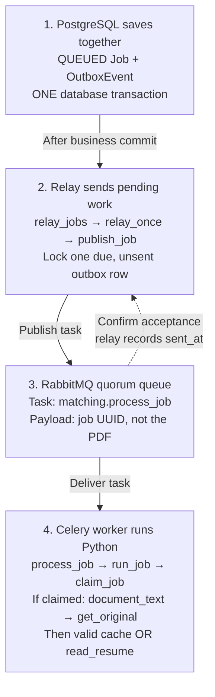

# Transactional outbox

**Save together. Send later.**

Without an outbox, the app could save a résumé job, then crash before telling a worker. The job exists, but the instruction to process it may be lost.

An **outbox** is a database table of dispatch reminders. Saving the job and its reminder together prevents that forgotten handoff. A **relay** is the background sender that turns a reminder into a task message.

## Follow one résumé job

Read the four numbered stages from top to bottom. The return arrow is RabbitMQ confirming receipt, not the worker reporting completion.

1. **Save together in PostgreSQL.** Django saves the job’s `QUEUED` state and an `OutboxEvent`, its dispatch reminder, in **one database transaction**. Both are saved, or neither is. This transaction finishes before sending to RabbitMQ.
2. **Let the relay send it.** The `relay_jobs` command repeatedly calls `relay_once`. That function locks one due, unsent reminder: one ready to send now. It calls `publish_job` to send the task. The lock prevents another relay selecting the same row at that moment.
3. **Queue the task in RabbitMQ.** Its quorum queue holds the task name, `matching.process_job`, and the job’s UUID, its unique identifier. **The message does not contain the PDF.** After RabbitMQ confirms acceptance, the relay records `sent_at` in the database. If publishing fails, the reminder stays pending.
4. **Run Python in the Celery worker.** RabbitMQ delivers the task. `process_job` calls `run_job`, which first uses `claim_job` to claim the work. If claimed, `document_text` calls `get_original` to fetch and safety-check the file. It then uses valid cached text or calls `read_resume` to parse the PDF/TXT. RabbitMQ holds messages; Celery runs this Python code.

## The same idea in a café

The cashier and order book represent **Django and PostgreSQL**. The runner is the **relay**, the waiting ticket rail is **RabbitMQ**, and the barista is the **Celery worker**. The saved reminder says “put this job’s ticket on the rail.”

In the picture, order **42** appears under both **ORDER** and **TO SEND**. The runner puts ticket **42** on the rail while the barista works on earlier ticket **17**: accepting new work and finishing earlier work happen separately.

The café explains the roles; a paper ledger does not provide database rollback, concurrency protection or duplicate controls.

## Why use it, and what is the catch?

**Benefit:** a crash or temporary RabbitMQ outage leaves a saved reminder to retry when the relay and queue recover.

**Cost:** work may start later, and retries can send twice. If RabbitMQ accepts a task but the relay crashes before saving `sent_at`, the reminder still looks unsent. The worker must tolerate repeated delivery. **Sent does not mean finished, and outbox does not mean exactly once.**

[Optional code boundaries and sources](reference.md) explain those safeguards. Remember: **save the job and reminder together; send the message later.**

Editable process diagram source

